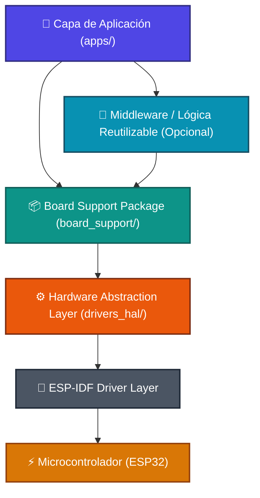

# ESP32 Playground 🛠️⚡

**ESP32 Playground** es un entorno de desarrollo, experimentación y testeo de aplicaciones embebidas para el microcontrolador **ESP32**, estructurado bajo una **arquitectura por capas estricta**.

El objetivo principal de este repositorio es permitir el desarrollo ágil, prototipado y testeo modular de aplicaciones de firmware, interactuando con el framework **ESP-IDF de forma indirecta a través de capas de abstracción (HAL y BSP)**.

---

## 🎯 Objetivos y Filosofía

- **Desacoplamiento del Vendor/SDK**: La capa de aplicación (`apps/`) no interactúa directamente con las APIs de bajo nivel del ESP-IDF (`driver/gpio.h`, registros de periféricos, etc.), sino mediante contratos limpios definidos en HAL y BSP.
- **Testabilidad y TDD**: La arquitectura modular facilita escribir pruebas unitarias tanto en target como en host mediante Unity y pytest.
- **Portabilidad y Reusabilidad**: Al encapsular las dependencias del microcontrolador en `drivers_hal` y las del circuito/placa en `board_support`, migrar de hardware o reutilizar lógica de negocio requiere cambios mínimos.
- **Aislamiento por CMake**: Las restricciones de arquitectura se hacen cumplir en tiempo de compilación mediante `PRIV_REQUIRES` e `INCLUDE_DIRS` estrictos en CMake.

---

## 🏗️ Arquitectura por Capas

El flujo de dependencias y llamadas es unidireccional y descendente:



---

## 📁 Estructura del Repositorio

```text
ESP32/
├── .gitignore
├── README.md                                # Documentación principal del repositorio
├── server/                                  # Servidor local de detección (YOLO) de 5_people_counter
└── firmware/
    ├── ESP32_playground.code-workspace      # Espacio de trabajo multi-root de VS Code
    ├── README.md                            # Documentación detallada de arquitectura y capas
    │
    ├── apps/                                # Proyectos ejecutables y pruebas
    │   ├── 0_blinking/                      # Aplicación básica de parpadeo de LED
    │   ├── 0_test_multi/                    # Tests automáticos con pytest
    │   ├── 0_test_runner/                   # Test runner interactivo con Unity en target
    │   ├── 1_touch/                         # Aplicación de prueba de sensores touch
    │   └── x_template/                      # Plantilla base para nuevas aplicaciones
    │
    ├── board_support/                       # BSP (LEDs, pulsadores, periféricos de placa)
    ├── drivers_hal/                         # HAL (GPIO, Touch, Timer, etc. sobre ESP-IDF)
    └── middleware/                          # Capas intermedias y animaciones
```

---

## 🚦 Reglas de Dependencias

| Capa | Puede llamar a | NO puede llamar a |
|---|---|---|
| **`apps`** | `middleware`, `board_support` | `drivers_hal`, APIs directas de `ESP-IDF` |
| **`middleware`** | `board_support`, `drivers_hal` | `apps`, APIs directas de `ESP-IDF` |
| **`board_support`** | `drivers_hal` | `apps`, `middleware`, APIs directas de `ESP-IDF` |
| **`drivers_hal`** | APIs de `ESP-IDF` | `apps`, `middleware`, `board_support` |

---

## 🚀 Cómo empezar

### 1. Requisitos
- [ESP-IDF](https://docs.espressif.com/projects/esp-idf/en/latest/esp32/get-started/) (v5.x / v6.x)
- Visual Studio Code con la extensión oficial de **ESP-IDF**

### 2. Abrir el Workspace
Abre el archivo de espacio de trabajo multi-carpeta en VS Code:
```text
firmware/ESP32_playground.code-workspace
```

### 3. Compilar y Flashear una App
1. Selecciona la carpeta de la app que desees ejecutar (ejemplo: `firmware/apps/0_blinking`).
2. Configura el puerto serie (`COMx` en Windows o `/dev/ttyUSBx` en Linux/macOS).
3. Compila, flashea y abre el monitor serie:
   ```bash
   idf.py build
   idf.py -p <PUERTO> flash monitor
   ```

### 4. Ejecutar Tests
- **En Target con Unity**: Abre `firmware/apps/0_test_runner`, compila y abre el monitor interactivo de tests.
- **Tests Automatizados**: En `firmware/apps/0_test_multi`, corre las pruebas basadas en pytest:
  ```bash
  pytest pytest_gpio_multi.py --port <PUERTO>
  ```
